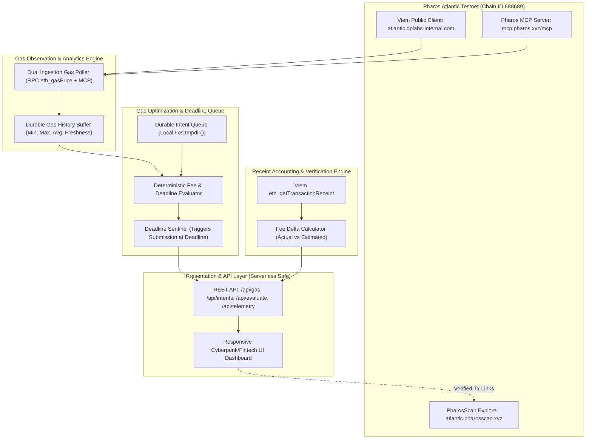

# ⚡ Pharos Gas Fee Optimizer

An autonomous gas-fee monitoring and deadline-aware transaction optimization agent for the **Pharos Atlantic Testnet (Chain ID 688689)**. Engineered for the **Pharos Agent Arena** and integrated with the official **Pharos MCP Server** (`mcp.pharos.xyz/mcp`).


---

## 🎯 Verification of Core Functional Requirements

| Requirement | Specification | Implementation Verification |
| :--- | :--- | :--- |
| **01** | Tracks gas price over time and shows recent history | **Verified**: Dual-source gas monitoring engine queries live `eth_gasPrice` via Viem and Pharos MCP `get_gas_price`. Persists observations and calculates real-time min, max, average, and data freshness. |
| **02** | Accepts a transaction with a deadline and holds it until gas is favorable or the deadline is reached | **Verified**: Intent scheduling engine accepts target fee ceiling (Gwei) and submission deadline. Holds intent in persistent queue with deterministic status explanations. |
| **03** | Reports actual gas paid compared with price at request time | **Verified**: Verified receipt accounting service retrieves `gasUsed` and `effectiveGasPrice` directly from PharosScan/RPC receipts to calculate actual fee paid, fee savings delta, and explorer transaction links. |
| **04** | Never misses the deadline; submits at the deadline even if gas is high | **Verified**: Deadline watchdog monitors queue on every block tick. When `Date.now() >= deadline`, the engine immediately elevates intent to `READY_DEADLINE_FORCED` state regardless of prevailing network gas spikes. |

---

## ⚡ Architecture & Dual Ingestion Engine



---

## 🚀 Quickstart & Local Execution

### 1. Prerequisites
- **Node.js**: `v20+` or `v24+`
- **npm**: `v10+`

### 2. Installation
```bash
git clone https://github.com/JimmyOgb/pharos-gas-fee-optimizer.git
cd pharos-gas-fee-optimizer
npm install
```

### 3. Build & Test
```bash
# Run automated verification suite (all 10 tests)
npm test

# Build production TypeScript bundles
npm run build
```

### 4. Run Locally
```bash
npm start
# Open http://localhost:3000
```

---

## 📡 REST API Reference

- `GET /api/gas`: Returns current gas price, EIP-1559 base fee, min/max/average, freshness indicator, and observation history (Requirement 01).
- `POST /api/gas/observe`: Forces an immediate live gas observation from the network.
- `GET /api/intents`: Returns all scheduled transaction intents and current optimization decisions (Requirement 02).
- `POST /api/intents`: Schedules a new non-urgent transaction intent with a target fee ceiling and forced deadline.
- `POST /api/evaluate`: Evaluates the active queue against live gas and triggers forced execution for expired deadlines (Requirement 04).
- `POST /api/intents/:id/broadcast`: Records transaction hash after user wallet signature.
- `POST /api/intents/:id/receipt`: Fetches verified on-chain receipt from Atlantic Testnet RPC and calculates actual fee comparison (Requirement 03).
- `GET /api/telemetry`: Real-time system health, latest block height, and MCP protocol status.

---

## 🛡️ Security Model & Wallet Safety

- **Zero Key Custody**: The optimizer never requests, stores, or logs private keys or seed phrases.
- **Client-Side Authorization**: When an intent reaches `READY_FAVORABLE` or `READY_DEADLINE_FORCED`, execution requires standard user wallet approval via browser EIP-1193 providers.
- **Fail-Closed Behavior**: If RPC connectivity drops or data becomes stale (>30s), the optimizer holds state and alerts the operator rather than making uninformed execution decisions.

---

## 📄 License
MIT License. Copyright (c) 2026 JimmyOgb.
