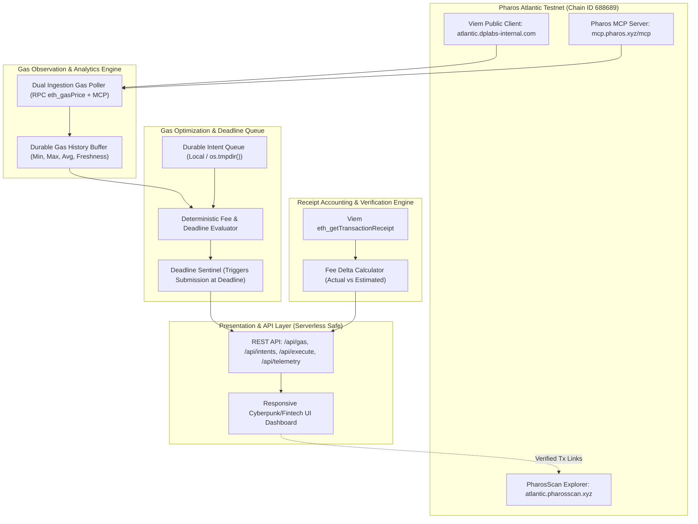

# Architecture: Pharos Gas Fee Optimizer

## System Workflow States
1. `PREPARED`: Transaction intent configured by operator with recipient, value, gas limit, fee ceiling, and deadline.
2. `HOLDING_FOR_FAVORABLE_GAS`: Current network gas price exceeds fee ceiling, and deadline has not expired.
3. `READY_FOR_EXECUTION (FAVORABLE_GAS)`: Gas dropped below fee ceiling.
4. `READY_FOR_EXECUTION (DEADLINE_FORCED)`: Deadline reached. Mandatory submission trigger activated regardless of gas price.
5. `BROADCASTED`: Transaction signed by user wallet and submitted to Atlantic Testnet mempool.
6. `CONFIRMED`: Receipt fetched from Atlantic RPC; actual gas used, effective price, fee delta, and PharosScan link recorded.
7. `FAILED_OR_EXPIRED`: Intent canceled or wallet signature rejected.
